<div align="center">

# SAKSHI

**Evidence-first document forensics for loan and KYC files.**<br>
Offline · CPU only · deterministic · every finding traced to the exact spot on the page

   

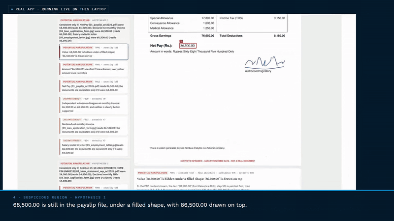

<sub>Real console footage (recorded with v1.0.2). The payslip says 86,500; SAKSHI finds 68,500 still inside the file, and recovers it.</sub>

**[Watch the demo (4:26, v1.1.1)](https://mahabu-subhani.github.io/sakshi/#demo)** · **[Sample dossier](https://mahabu-subhani.github.io/sakshi/samples/DEMO-TAMPERED_dossier.html)** · **[Quick start](#quick-start)** · **[Results](#results)**

</div>

*Sakshi* (साक्षी) is Hindi for *witness*. SAKSHI reads every document in a loan application, weighs how reliable each one is, and cross-examines them against each other. Instead of a fraud score it asks one question: **what would the documents have to say for every rule to hold?** The answer points at the edited field, often recovers its original value, and comes with the exact evidence an analyst can check in seconds. It never says "fraud"; a human decides.

<div align="center">

| **9 / 9** | **9 / 9** | **5 / 5** | **0 / 1,324** | **424 / h** |
|:---:|:---:|:---:|:---:|:---:|
| planted manipulations found on the demo application, original net pay recovered | red-team attacks caught; 7 of 7 genuine look-alikes clean | regenerated statements caught with the bank's own record (0 of 2 without it) | real genuine documents from three public datasets escalated to the top rung | five-document cases an hour on one laptop, four workers |

</div>

Every number above comes from a test in this repository that anyone can rerun ([`docs/RESULTS.md`](docs/RESULTS.md)), and the weaknesses are measured just as openly. Read the 0 / 1,324 with its other half: none of 300 real tampered images (RTM) reached the top rung either. On a single real image the top rung is cautious, not a detector for real image edits; SAKSHI's detection on loan files comes from arithmetic, cross-document rules, PDF structure and the bank's record, and the 9 / 9 and 5 / 5 results are on synthetic documents built for this project. See [Results](#results) and [Limitations](#limitations).

Built for the DataOps Innovation Hackathon problem *AI-Powered Document Forensics and Contextual Intelligence System*.

<details>
<summary><b>What's new in 1.1</b></summary>

* **The bank's own record.** Account Aggregator FI data (ReBIT deposit format, XML or JSON) supplied by the lender is reconciled row by row with the uploaded statement, which catches a regenerated statement that no document can reveal.
* **Signed PDFs.** Broken signatures and content added after signing are reported offline; a document counts as issuer-signed only through the lender's own certificate store.
* **Built to plug in.** `sakshi batch` and a REST API with a bearer token, each case in its own process with a hard timeout; 124 cases an hour on one worker, 424 on four.
* **Fairer cross-case memory.** When two applicants share an identity, arrival order decides nothing: both sides stay *contested* until the bank's record settles who owns the identifier.
* **Reproducible.** `requirements.lock` pins every library; each dossier records the OCR engine it used and warns when it differs from the calibrated one.
* **1.1.1, from a real document.** A real born-digital document made with LaTeX, tested privately, showed that a white box over one number inside a whole-line text run went unseen. It is now found and the original value recovered, and a sensor that misses its own planted canary is reported *blind on this document*, never clean.
* **1.1.1 signatures.** Coloured printed text (a navy letterhead) is no longer mistaken for ink; signature images pasted into born-digital PDFs are found, and one added in a later save is reported.

Full history: [`docs/CHANGELOG.md`](docs/CHANGELOG.md).

</details>

<details>
<summary><b>How SAKSHI covers the problem statement</b></summary>

| The brief asks for | Where SAKSHI does it |
|---|---|
| Upload and process multiple documents of one application | console uploader, `python -m sakshi run`, `batch` and the REST API; each console, batch or API case in its own worker process; a capability matrix in the console states what is implemented, partial, planned and unsupported |
| Classification and OCR | dossier 7.1: type, confidence, cues, modality, witness level, SHA-256 |
| Structured representation of the content | dossier 7.2: every field with raw and normalised value, confidence, method and location |
| Visual forensics with suspicious regions highlighted | nine pixel sensors, PDF layer archaeology and overlay peel; every hit boxed on its page (7.4) |
| Contextual and cross-document verification | rules, counterfactual repair, claim graph and income triangulation (7.3); the bank's own record (Account Aggregator data) when the lender supplies it; signed-PDF verification |
| Relationships between findings | findings grouped into hypotheses that support each other |
| Potential versus confirmed anomalies | three rungs, devil's advocate, witness levels; never "fraud" |
| Traceable evidence and a final dossier | 7.5 traceability (click to the boxed region), 7.6 summary, HTML / JSON / hash-chained audit |
| Safe failure and stated limits | damaged files rejected with a reason (an upload of only unreadable files is reported as nothing analysed, never as clean), forgery canaries, coverage map, `docs/LIMITATIONS.md` |

</details>

## What it finds

| Demo payslip · counterfactual repair | Red-team payslip RT8 · overlay peel |
|---|---|
| 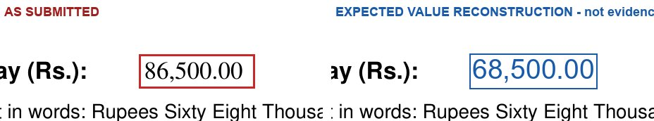 | 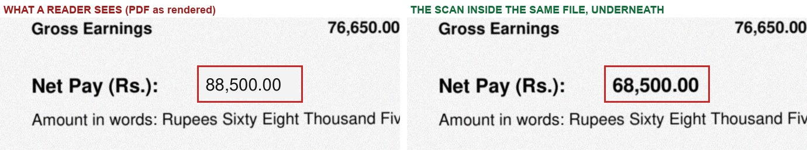 |
| The payslip's own arithmetic and the amount in words only add up if net pay were **68,500**. SAKSHI finds the smallest set of field changes that makes every rule hold, and PDF layer archaeology independently finds 68,500 painted over in the file. | A scanned payslip edited in a PDF editor: a box hides the real figure and new text is typed on top. The scan itself is untouched, so pixel forensics alone see nothing. SAKSHI peels the layers apart. |

It also recovers the earlier saved version of an edited PDF and shows what changed (on the demo payslip: 68,500.00 before the later save, 86,500.00 after), flags hidden text that tells automated reviewers to ignore anomalies, and catches a digit copied from elsewhere on a scanned statement, a white-out and retype on an application form, an EMI row deleted from a statement, an October payslip made from September's scan, a spliced ID photo, and the same ID photo or salary account reused by a "different" applicant across cases.

**With the bank's own record it also catches what no document can reveal.** A statement regenerated with one amount changed and every later balance recomputed is internally perfect; from the documents alone SAKSHI reports that field as blind. Attach the Account Aggregator data for the account (the lender's FI data in the ReBIT deposit format, XML or JSON) and every statement row is reconciled against the bank's record: on the demo, *"The bank's own record shows 24,500.00 where the uploaded statement shows 14,500.00"*, and the Forgery Lab's regenerated statement is caught 5 times out of 5. SAKSHI reads that file; it is not an FIU and fetches nothing from the AA network.

## See it

| The review console | The investigation dossier |
|---|---|
| 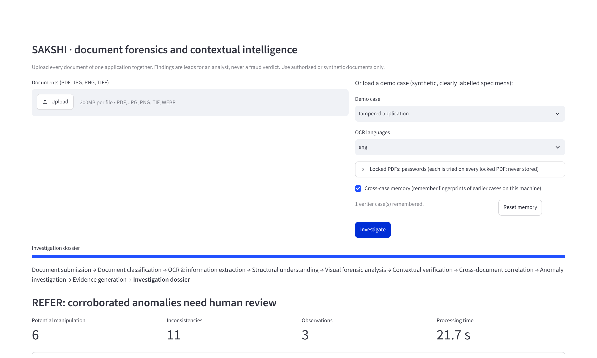 | 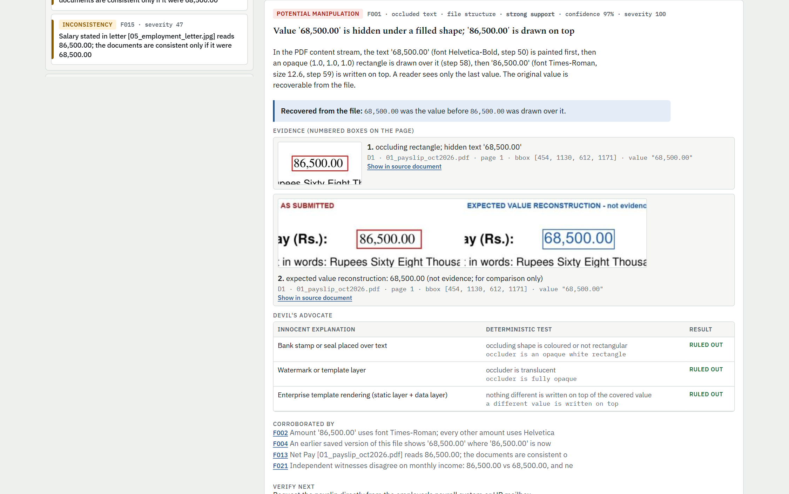 |
| **Cross-document claim graph** | **Coverage map** |
| 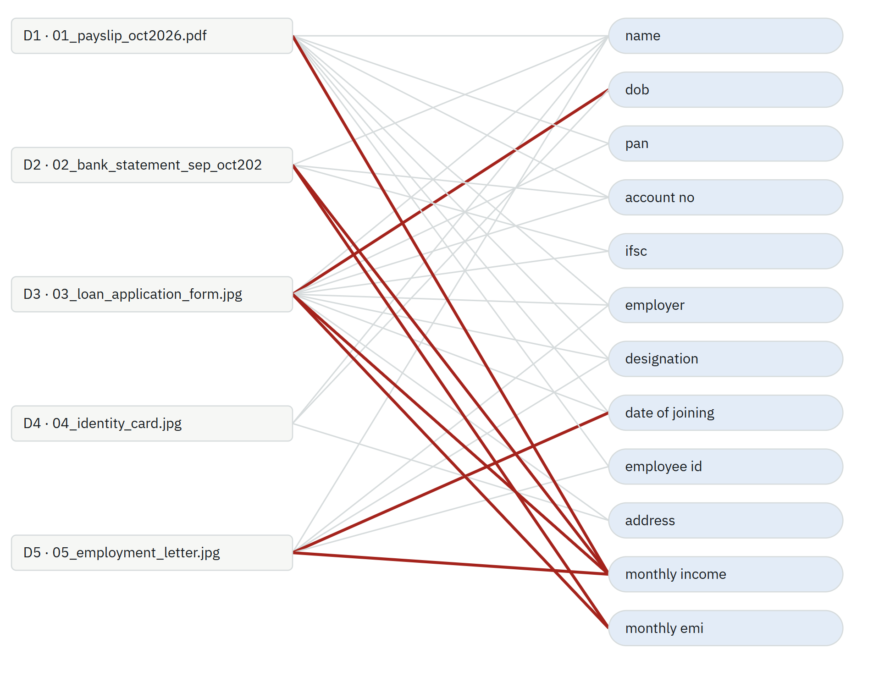 | 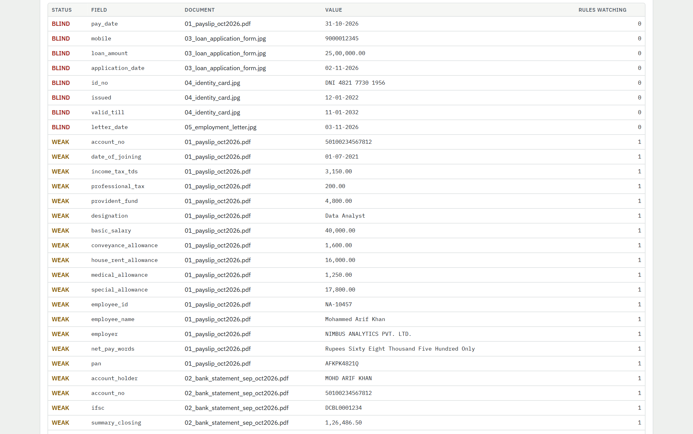 |

Each case produces a self-contained `dossier.html` (every finding clickable to its box on the original page), a machine-readable `dossier.json`, and a hash-chained `audit.jsonl`. Open the samples in your browser on the [project page](https://mahabu-subhani.github.io/sakshi/#samples), or download one from [`samples/`](samples) and open it locally.

## How it decides

| Rung | Meaning |
|---|---|
| **OBSERVATION** | Something differs, and an innocent reason explains it (`MOHD ARIF KHAN` vs `Mohammed Arif Khan`). |
| **INCONSISTENCY** | A rule is broken, but an innocent reason is still possible (a date of birth one digit apart). |
| **POTENTIAL MANIPULATION** | Two independent evidence families agree, or there is a smoking gun, and no innocent explanation survives. |

Every finding states its **strength of evidence** in words (strong, moderate or weak support; or explained), the way forensic reports do, next to its confidence. Every finding first faces a **devil's advocate**: a catalogue of innocent explanations (rounding, OCR misread, transliteration, JBIG2 compression, salary revision, timing), each with a deterministic test. Evidence is weighed by **witness level**: an applicant's own form (L0) counts less than a scanned letter (L1), which counts less than a payslip, statement or ID (L2). A **coverage map** marks every field strong, weak or blind, so silence is never reported as "clean".

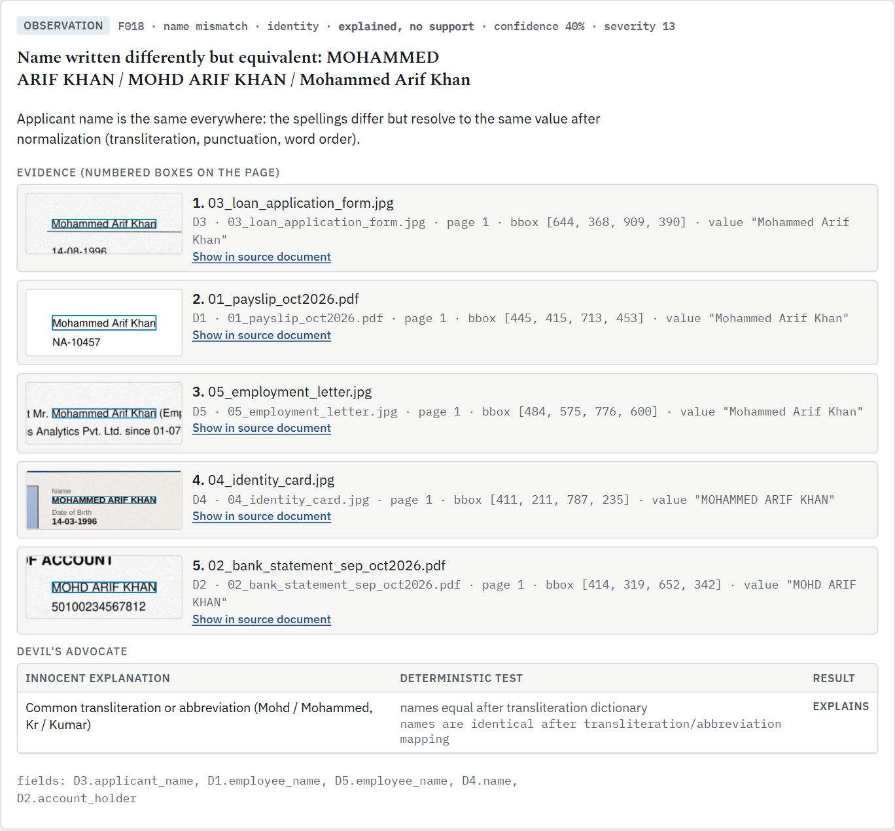

## How it works

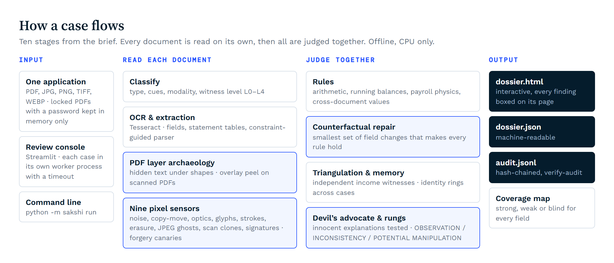

Every number SAKSHI reports comes from deterministic code: rules, solvers and image statistics. OCR is Tesseract; nothing is decided by a language model. An optional narrator can call an LLM API to reword the final summary; it is off by default and never decides a rung.

<details>
<summary><b>The core techniques</b></summary>

| Technique | What it does | Code |
|---|---|---|
| Counterfactual repair | Treats the documents as a program with invariants (gross = sum of earnings, net = gross - deductions, running balances, payslip net = salary credit, declared EMI = EMI debits) and finds the smallest, most plausible set of field changes (up to 3, weighted by witness level and OCR confidence) that makes every rule hold. | `reasoning/repair.py` |
| PDF layer archaeology | Finds values covered by a filled shape in born-digital PDFs and recovers the hidden original from the content stream; when a whole line is one text run (LaTeX and similar), the covered characters are measured on their own. | `forensics/pdf_layers.py` |
| Overlay peel | Renders what a reader sees, extracts the bare scan from the same file and compares them; covers objects, comment annotations and nested XObjects, and recognises redactions. | `forensics/scan_overlay.py` |
| Nine pixel sensors | Paper noise, copy-move (scanner grain), scanner optics, glyph typography, intra-number strokes, erasure patches, JPEG ghosts, scan clones, signature ink. | `forensics/` |
| Signatures | Blue ink anywhere on the page, except inside words read confidently as printed text; black ink just above a readable signature caption; signature images pasted into born-digital PDFs, with one added in a later save reported. The same stroke shape on two documents where one is a supposed wet signature is a reproduced signature. | `forensics/signature.py` |
| Constraint-guided statement parser | Picks the column layout (debit/credit, credit/debit, amount + Dr/Cr, signed amount) that makes the running balance hold; doubtful cells get a second OCR pass that never sees the expected value. | `forensics/table_parser.py` |
| Income triangulation | Weighs every independent witness to monthly income; a self-contradicting document is impeached, but the part that exposes the contradiction keeps its weight. Without a clear majority, nobody is blamed. | `reasoning/engine.py` |
| Payroll physics, deleted rows | Employee PF must be at least 12% of the basic printed; a balance break whose gap equals a missing recurring EMI, with no printed line between the rows, is a removed row. | `reasoning/invariants.py`, `reasoning/engine.py` |
| Forgery canaries | Before trusting a sensor's silence, SAKSHI forges each upload in memory from its own pixels; a sensor that misses its own canary reports "blind on this document". | `reasoning/selftest.py` |
| Earlier-version recovery | An incremental save appends changes after the original end-of-file marker; cutting the file there recovers the document as it was, and values that changed at the same place are reported with their earlier reading. | `forensics/pdf_layers.py` |
| Hidden instructions, grounded narrator | Invisible text addressed to automated reviewers is a finding. The optional LLM narrator gets document text only as quoted data; its output is discarded unless every sentence cites a real finding id and every potential-manipulation finding is covered. | `forensics/pdf_layers.py`, `reasoning/narrator.py` |
| The bank's own record | Account Aggregator FI data in the ReBIT deposit schema is an L4 witness: every statement row is matched to the bank's transactions and each difference is boxed on the page. Data for a different account compares nothing and says so. | `issuer.py` |
| Signed PDFs | pyHanko checks every signature offline: integrity, content added after signing, and whether the certificate chains to CA certificates in the lender's `SAKSHI_TRUST_DIR` (only then L3). | `forensics/pdf_signature.py` |
| Cross-case memory | Fingerprints of earlier cases (photo hash, PAN, account numbers, file hashes, signature grids) expose identity rings. A shared identity is contested on both sides whatever the arrival order, until the bank's record shows whose identifier it is. | `registry.py` |
| Batch and REST API | Each case runs in an isolated worker process with a hard timeout; the API requires a bearer token before it listens beyond localhost. | `service.py` |
| Hash-chained audit | Every stage and finding is logged with the hash of the previous entry; `verify-audit` detects any later edit. | `audit.py` |

The ten stages follow the brief: document submission, classification, OCR and extraction, structural understanding, visual forensic analysis, contextual verification, cross-document correlation, anomaly investigation, evidence generation, investigation dossier. Methods and thresholds are in [`docs/TECHNICAL.md`](docs/TECHNICAL.md); the data flow is in [`docs/ARCHITECTURE.md`](docs/ARCHITECTURE.md).

</details>

## Results

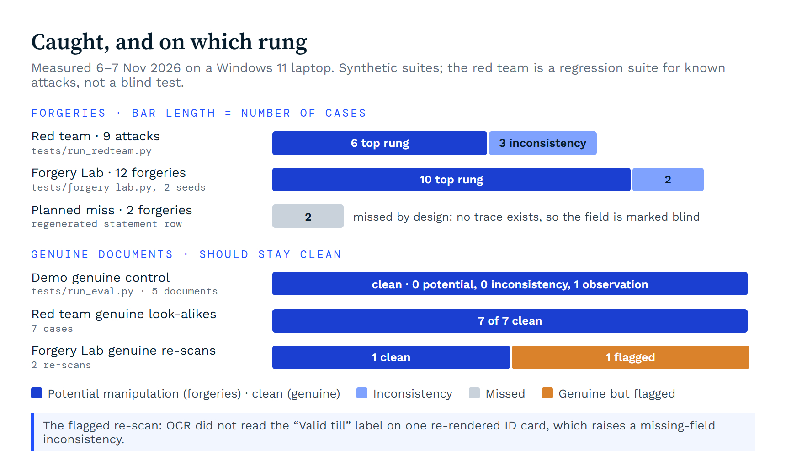

Extraction is measured against the generator's ground truth: **48 of 48 fields** and **13 of 13 statement rows** exact on the clean demo documents, **18 of 19 fields** on WhatsApp-forwarded phone photos (one PAN not read), with no wrong value extracted. On the demo application, all **9 planted manipulations** are found (14 of 14 expected detections) and the original net pay of **68,500** is recovered; the same applicant's genuine documents come back with **0 potential manipulation and 0 inconsistencies**. The synthetic suites were built for this project, and the red team is a regression suite for known attacks, not a blind test. So SAKSHI was also run, unchanged, on public data it was never tuned for:

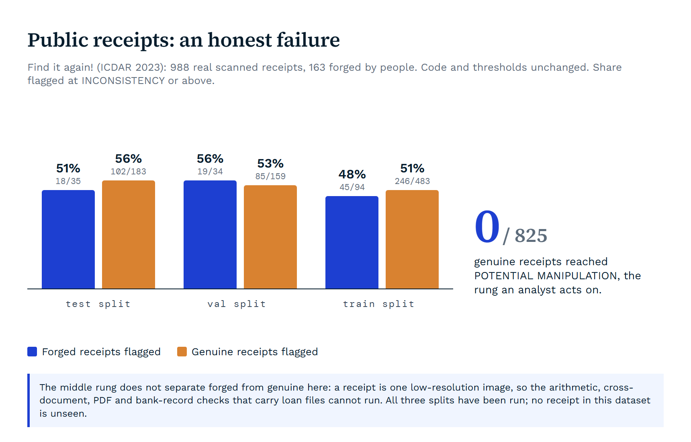

On real receipts the middle rung cannot separate forged from genuine, and that is stated plainly; a learned layer trained on the receipts' own train split did not fix it (ROC AUC 0.60 and 0.54, intervals including 0.5), so it is published as a negative result and not used. The rung an analyst acts on held: **none of 825 genuine receipts, and none of 199 real scanned business forms (FUNSD), was escalated to potential manipulation**, though the middle rung flags about one real business form in four. On 600 real document images from RTM (300 tampered by people), the pixel sensors flagged tampered and genuine images at the same rate (31% and 33%) and boxed the edit in only 17 of 300: they are not a detector for real single-image tampering, and none of the 300 genuine images reached the top rung either (0 of 1,324 real genuine documents in all). A five-document case takes **25-80 s** on a laptop CPU. Full tables, commands and caveats: [`docs/RESULTS.md`](docs/RESULTS.md).

## Quick start

Python 3.10+ and the Tesseract OCR 5 binary (English; Hindi optional).

```bash
# Ubuntu: sudo apt install tesseract-ocr tesseract-ocr-hin
# Windows: UB Mannheim installer, then add it to PATH.  macOS: brew install tesseract tesseract-lang
pip install -r requirements.txt   # or requirements.lock for the exact versions this release was tested with

streamlit run app.py              # review console: upload documents or pick a demo case
python -m sakshi demo             # investigate both demo cases (--regenerate rebuilds them on this machine first)
python -m sakshi run a.pdf b.jpg --out out/mycase [--lang eng+hin] [--memory registry.json] [--password PW]
python -m sakshi verify-audit out/mycase/audit.jsonl
python -m sakshi batch applications/ --out out/batch --workers 4   # one sub-folder per application, in parallel
python -m sakshi serve --port 8600 --workers 4                     # REST API: POST /v1/cases (see below)
```

**Or with Docker** (Tesseract with English and Hindi included, no local install):

```bash
docker build -t sakshi .
docker run --rm -p 8501:8501 sakshi          # review console at http://localhost:8501
docker run --rm -v "$PWD/in:/data" sakshi python -m sakshi run /data/a.pdf /data/b.jpg --out /data/out
```

The image uses Tesseract 5.5, which reads one character of the IFSC differently on the scanned statement and application form (`DCBLO0001234` for `DCBL0001234`, at OCR confidence 0.30). In Docker the demo case therefore shows 7 / 11 / 5 instead of 7 / 11 / 3, the genuine control 0 / 0 / 3 instead of 0 / 0 / 1, red-team RT8 5 / 1 / 3 instead of 5 / 1 / 1, and extraction 46 / 48 instead of 48 / 48. The test suites therefore compare against counts measured on the same machine, not against these numbers. The extra findings are observations explained as an OCR confusion; every other result is the same.

<details>
<summary><b>Run the test suites</b></summary>

```bash
python tests/run_eval.py                  # every planted manipulation found, genuine control clean
python tests/run_redteam.py               # red-team cases and genuine look-alikes
python tests/forgery_lab.py --seeds 2     # forgery recipes on fresh documents + genuine re-scans
python tests/run_long_statement.py        # 13-page statement edited on page 8, and a locked copy
python tests/run_registry_chain.py        # every case back to back into one cross-case memory
python tests/run_registry_lock.py         # eight cases written to the memory at the same moment
python tests/run_console_worker.py        # the console's isolated worker
python tests/run_extraction_accuracy.py   # field-level extraction accuracy against ground truth
python tests/run_signatures.py            # black-ink signatures: detection, identity, no false signatures
python tests/run_prompt_injection.py      # hidden instructions caught; the narrator cannot be steered
python tests/run_issuer.py                # bank's own record (Account Aggregator data) reconciled with the statement
python tests/run_pdf_signatures.py        # signed PDFs: edits after signing, broken signatures, trust store
python tests/run_pdf_layer_lines.py       # text hidden under a box when a whole line is one text run (LaTeX)
python tests/run_signature_images.py      # coloured print is not a signature; pasted signature images are seen
python tests/run_service.py               # batch mode and REST API: same results in parallel, token required
python tests/run_rejected_files.py        # every file unreadable: reported as nothing analysed, never as clean
python tests/run_findit.py --data PATH/TO/findit2   # public receipts (download the dataset first)
python tests/learn_receipts.py --runs OUTDIR        # learned layer on the receipts: train split only, scored once
python tests/run_image_benchmark.py --images DIR --name NAME --out OUTDIR [--tampered-list FILE]   # FUNSD, RTM
python tests/score_localization.py --bench OUTDIR --masks DIR                                      # boxes vs masks
python tests/bench_throughput.py --workers 4        # cases per hour, 1 worker vs 4
```

</details>

## Deploying it

| Need | What SAKSHI provides |
|---|---|
| Integrate with a loan-origination system | `sakshi serve`: `POST /v1/cases` (multipart `files`, optional `case_id`) returns a job; `GET /v1/cases/{id}` gives status, verdict and counts; the dossier, JSON and audit trail download from the job. A bearer token (`SAKSHI_API_TOKEN`) is required before it listens beyond localhost. |
| Volume | `sakshi batch` and the API run several cases side by side, each in its own process with a hard timeout; a stalled case cannot take the others down. Measured on a 12-thread laptop: 124 five-document cases an hour on one worker, 424 on four, with identical results. |
| The bank's record | Account Aggregator FI data (ReBIT deposit schema) attached as a file is an L4 witness: row-by-row reconciliation with the statement, boxed on the page. |
| Issuer-signed documents | Signed PDFs are checked offline: a broken signature or content added after signing is reported. A document counts as issuer-signed (L3) only when its certificate chains to CA certificates the lender puts in `SAKSHI_TRUST_DIR`; none ship with SAKSHI, and revocation is not checked. |
| Reproducible results | `requirements.lock` pins every library; each dossier records the OCR engine and library versions and warns when Tesseract differs from the calibrated 5.4. |

## Limitations

* Thresholds were calibrated on synthetic data. Real-world testing so far is three public datasets (1,324 genuine documents, none escalated to the top rung) and one real born-digital document made with LaTeX, tested privately; SAKSHI has not been tested on real Indian payslips or statements, because no public set exists.
* On real single images (receipts, RTM) the pixel sensors flag forged and genuine documents at about the same rate, so the middle rung does not separate them there.
* Handwriting is not read: a Microsoft TrOCR trial read FUNSD's real forms worse than Tesseract and was not adopted.
* A statement row changed with every later balance regenerated leaves no trace in the documents; that field is reported blind unless the bank's own record is attached.
* Pixel forensics run on the first 6 pages (up to 40 are read); black-ink signatures are found only just above a readable signature caption.
* The bank's record is read from a file the lender supplies; SAKSHI does not fetch it as an FIU, and UIDAI and PAN verification are not connected. Cross-case memory flags a shared identity as contested on both sides until the bank's record settles it (photos stay contested), and has no per-applicant erasure yet.

More in [`docs/LIMITATIONS.md`](docs/LIMITATIONS.md). Next: calibration on consented real documents, a resolution gate for the pixel sensors judged on newly collected receipts (all 988 public receipts have been seen), live AA fetching as a registered FIU, and UIDAI and PAN verification.

## Documentation

| Document | What is in it |
|---|---|
| [`docs/RESULTS.md`](docs/RESULTS.md) | every measured result, the command that produces it, and its caveats |
| [`docs/LIMITATIONS.md`](docs/LIMITATIONS.md) | capability matrix (implemented, partial, planned, unsupported) and known failure modes |
| [`docs/TECHNICAL.md`](docs/TECHNICAL.md) | methods and thresholds, sensor by sensor |
| [`docs/ARCHITECTURE.md`](docs/ARCHITECTURE.md) | data flow, modules, evidence model, where the AI is and is not |
| [`docs/FORGERY_LAB_RESULTS.md`](docs/FORGERY_LAB_RESULTS.md) | forgery recipes on freshly generated documents |
| [`docs/CHANGELOG.md`](docs/CHANGELOG.md) | what changed in each release |

## Built with

Python · PyMuPDF · Tesseract 5 · OpenCV · scikit-image · NumPy · Pillow · pyHanko · Streamlit · Starlette and Uvicorn · ReportLab (synthetic test data). Everything runs on one laptop and documents never leave it (if the optional narrator is switched on, it sends only the structured findings to an LLM API, never the documents).

Use only authorised or synthetic documents. Every document in this repository is synthetic and labelled SYNTHETIC SPECIMEN, except the public receipts, which are not bundled.

Built by **Mahabu Subhani Mohammed**.

**Licence:** MIT ([`LICENSE`](LICENSE)). PyMuPDF is AGPL-3.0, which matters for any hosted or commercial deployment. [Changelog](docs/CHANGELOG.md).
