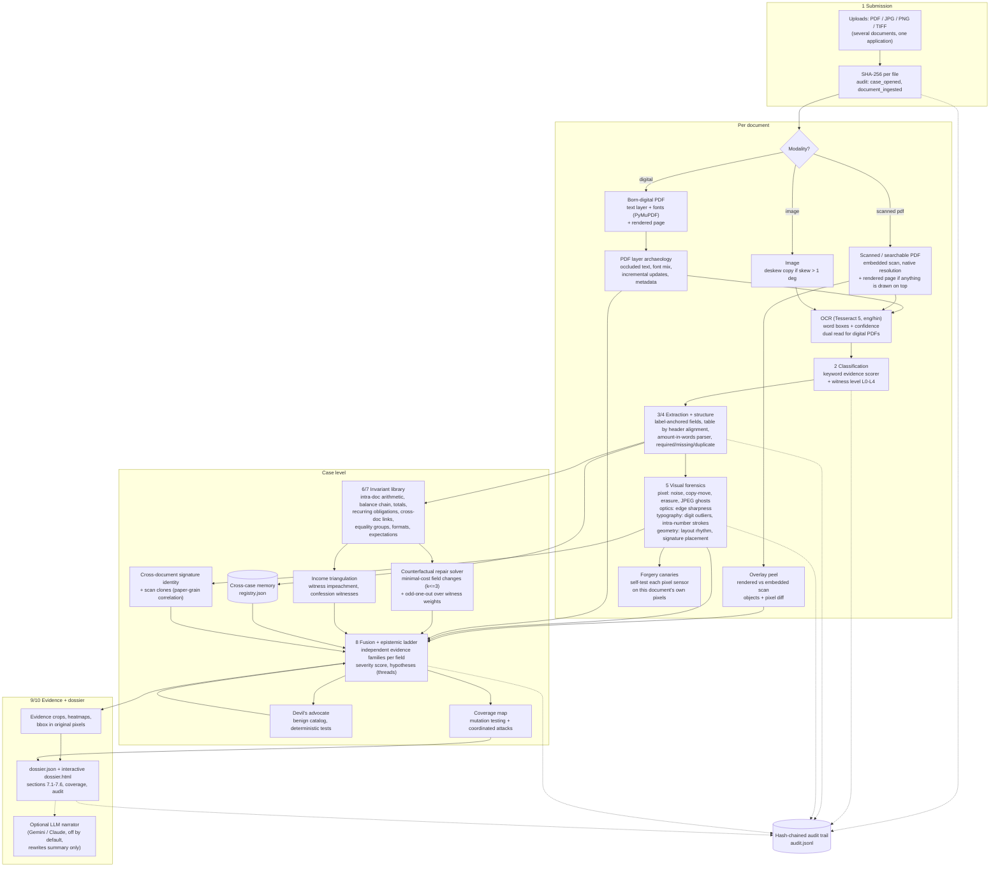

# SAKSHI architecture

## Data flow



## Modules

| Stage of the brief | Module | Technology | Role |
|---|---|---|---|
| Document submission | `ingest.py`, `audit.py` | PyMuPDF, Pillow, hashlib | hashing, modality detection, native-resolution rasters, deskew, chain of custody |
| Classification | `classify.py` | keyword evidence scorer | type + confidence + cues, witness level |
| OCR & extraction | `ingest.py`, `extract.py` | Tesseract 5 (LSTM), PDF text layer | word boxes + confidence, label-anchored fields, table parsing, number-words parser |
| Structural understanding | `extract.py` | layout geometry | sections, required/missing/duplicate fields, label-value relations, row/column structure |
| Visual forensics | `forensics/*.py` | OpenCV, scikit-image, NumPy | noise consistency, copy-move, typography, layout rhythm, signatures, PDF archaeology; v1.0: `compression.py`, `raster.py` (stroke, optics, scan clones), `scan_overlay.py` (overlay peel), `table_parser.py` |
| Cross-case memory | `registry.py` | pHash, SHA-256, stroke grids | identity rings across applications; a shared identity is contested on both sides until the bank's record settles it (v1.1) |
| Bank's own record (v1.1) | `issuer.py` | ReBIT deposit schema (XML/JSON) | Account Aggregator FI data supplied by the lender, an L4 witness reconciled row by row with the statement |
| Signed PDFs (v1.1) | `forensics/pdf_signature.py` | pyHanko | integrity, content added after signing, issuer-signed (L3) only through `SAKSHI_TRUST_DIR` |
| Batch and REST API (v1.1) | `service.py`, `cli.py` | Starlette, Uvicorn, multiprocessing | isolated worker per case with a hard timeout, bearer token, `sakshi batch` / `sakshi serve` |
| Contextual verification | `reasoning/invariants.py`, `engine.py` | rule library | arithmetic, balance chain, totals, formats (PAN/IFSC), dates, expectations |
| Cross-document correlation | `invariants.py`, `repair.py` | linear algebra, entity matching | cross-doc numeric links, equality groups with transliteration and OCR-confusion handling |
| Anomaly investigation | `repair.py`, `devils_advocate.py`, `fusion.py` | model-based diagnosis, deterministic tests | minimal repairs, innocent explanations, tiering, hypotheses |
| Evidence generation | `pipeline.py` | OpenCV | crops with boxes, heatmaps, page references |
| Investigation dossier | `dossier/render.py` | self-contained HTML + JSON | interactive traceability, coverage, audit |
| Self-assessment | `reasoning/coverage.py`, `selftest.py` | mutation testing, canaries | what the system can and cannot verify on this case |
| (optional) LLM | `reasoning/narrator.py` | Gemini / Claude API | plain-language restatement of the deterministic summary |

## Evidence model

```
Field   { name, raw, value, kind, doc_id, page, bbox(px), conf, method, ref }
Finding { id, check, family, tier, confidence, severity, evidence[], fields[], benign[], repair{}, corroborated_by[] }
Evidence{ doc_id, page, bbox(px), note, value, crop }
```

Evidence families used for corroboration (v1.0): `file_structure`, `pixel`, `optics`, `typography`, `geometry`, `signature`, `logical` (internal arithmetic), `cross_document` (external records), `identity`, `pattern`, `statutory`, `cross_case`. Pixel statistics count as one family because one paste moves them all. A field reaches POTENTIAL MANIPULATION only when two or more families converge on it (or a smoking gun such as recovered occluded text) **and** no innocent explanation remains plausible. Weak sensors (alignment, typography) can corroborate but never lead.

## Where the AI is, and where it deliberately is not

* Learned models: Tesseract's LSTM OCR. Statistical learning: robust z-scores, Theil-Sen fits, noise estimation, all per document (unsupervised, no training data needed, because judges bring unseen documents).
* Reasoning: deterministic model-based diagnosis, so every conclusion can be replayed and audited.
* LLMs: optional, and only to *rephrase* the final summary. Never to decide a tier, never on raw documents: the LLM proposes wording, deterministic code decides.
